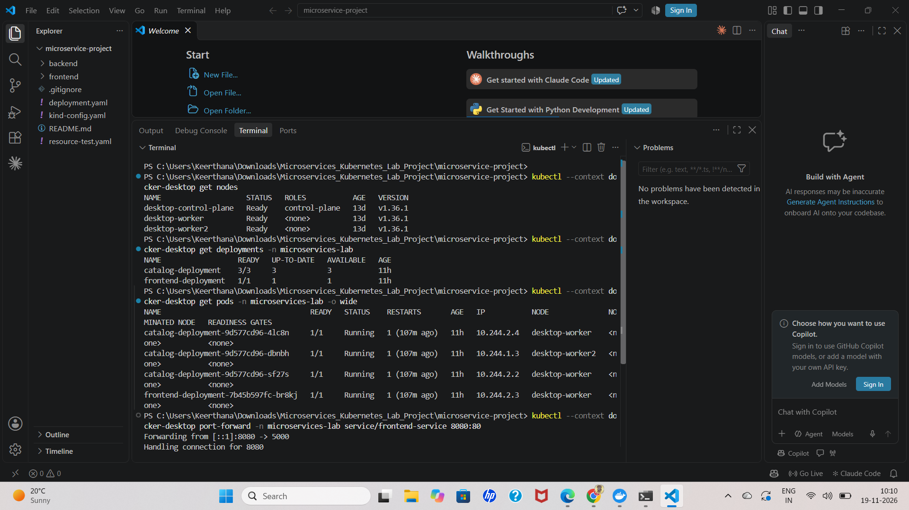
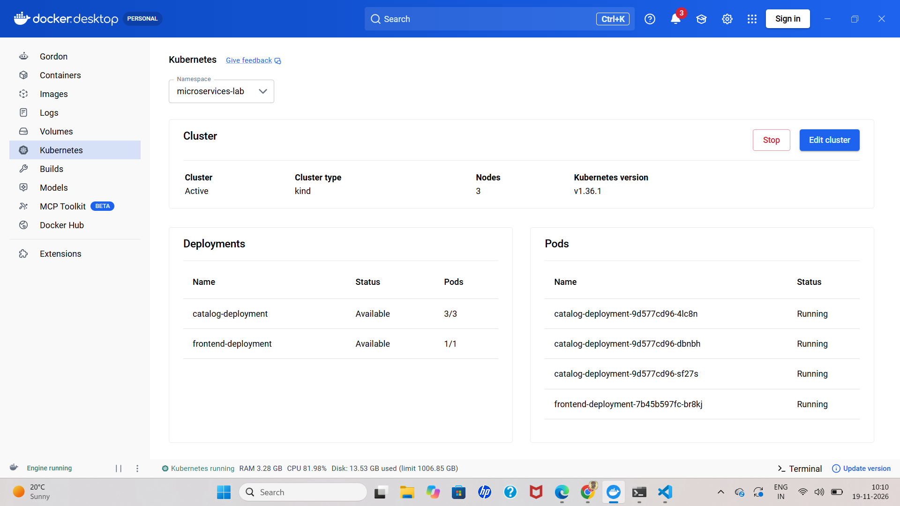
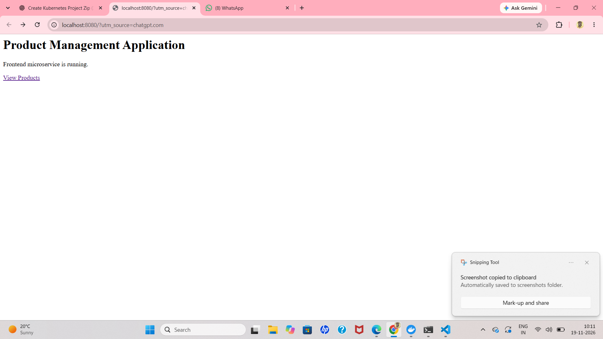
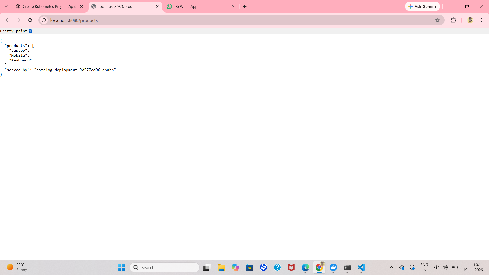

# Kubernetes Microservices Deployment Lab

A two-service product management demonstration deployed on Kubernetes using Docker Desktop's built-in kind cluster. The frontend communicates with a Catalog backend through an internal Kubernetes Service.

## 1. Project overview

| Component | Technology | Kubernetes resource | Container image |
|---|---|---|---|
| Frontend | Python + Flask | Deployment + ClusterIP Service | `frontend:v1` |
| Catalog backend | Python + Flask | Deployment + ClusterIP Service | `catalog:v1` |
| Cluster | Docker Desktop Kubernetes (kind) | 3 nodes | Kubernetes v1.36.1 |

**Observed final state in Docker Desktop Kubernetes:**
- 3 Kubernetes nodes: one control-plane and two workers.
- `catalog-deployment`: 3/3 replicas available.
- `frontend-deployment`: 1/1 replica available.
- Four application Pods in total, all Running and Ready.
- The browser frontend loaded at `http://localhost:8080`.
- The `/products` endpoint returned `Laptop`, `Mobile`, and `Keyboard`, together with the backend Pod name that served the request.

## 2. Architecture

```text
Browser
  |
  | http://localhost:8080
  v
Port-forward (local machine -> frontend-service:80)
  |
  v
frontend-service (ClusterIP)
  |
  v
Frontend Pod (Flask)
  |
  | HTTP request to http://catalog-service:5000/products
  v
catalog-service (ClusterIP)
  |
  +------> Catalog Pod 1
  +------> Catalog Pod 2
  +------> Catalog Pod 3
```

The frontend and catalog services communicate using Kubernetes DNS service discovery. The frontend uses the stable DNS name `catalog-service`; it does not need to know individual Pod IP addresses.

## 3. Repository structure

```text
microservice-project/
├── backend/
│   ├── app.py
│   ├── requirements.txt
│   └── Dockerfile
├── frontend/
│   ├── app.py
│   ├── requirements.txt
│   └── Dockerfile
├── deployment.yaml
├── kind-config.yaml
├── resource-test.yaml
├── .gitignore
├── README.md
├── docs/
│   └── COMMAND_REFERENCE.md
└── screenshots/
    ├── 01-vscode-terminal-and-port-forward.png
    ├── 02-docker-desktop-kubernetes-workloads.png
    ├── 03-frontend-homepage.png
    └── 04-products-api-response.png
```

## 4. Requirements

- Windows 10/11
- Docker Desktop with Kubernetes enabled
- Docker CLI
- `kubectl`
- PowerShell
- VS Code (recommended)

The supplied project images are `catalog:v1` and `frontend:v1`. If you rebuild them, load them into the target cluster before applying the manifests.

## 5. Run the project on Docker Desktop Kubernetes

Open PowerShell in the project root directory.

### Step 1 — Confirm the Kubernetes context

```powershell
kubectl config get-contexts
kubectl config current-context
kubectl config use-context docker-desktop
```

- `get-contexts` lists Kubernetes contexts configured on this computer.
- `current-context` displays the context currently selected by `kubectl`.
- `use-context` switches `kubectl` to Docker Desktop's cluster.

### Step 2 — Check the cluster nodes

```powershell
kubectl --context docker-desktop get nodes
```

Lists the nodes and their readiness state. In this run, the three nodes were `desktop-control-plane`, `desktop-worker`, and `desktop-worker2`, all `Ready`.

### Step 3 — Create a dedicated namespace

```powershell
kubectl --context docker-desktop create namespace microservices-lab
```

Creates a namespace to keep this lab's Kubernetes resources separate from workloads in the `default` namespace.

### Step 4 — Deploy the services

```powershell
kubectl --context docker-desktop apply -f deployment.yaml -n microservices-lab
```

Creates or updates both Deployments and both Services defined in `deployment.yaml`.

### Step 5 — Wait for Pods and Deployments

```powershell
kubectl --context docker-desktop get pods -n microservices-lab -w
kubectl --context docker-desktop rollout status deployment/catalog-deployment -n microservices-lab
kubectl --context docker-desktop get deployments -n microservices-lab
kubectl --context docker-desktop get pods -n microservices-lab -o wide
```

- `get pods -w` watches Pod state changes continuously; press `Ctrl+C` after the Pods are Running.
- `rollout status` waits for the Deployment rollout to complete.
- `get deployments` displays desired, updated, and available replica counts.
- `get pods -o wide` also displays Pod IP addresses and the nodes hosting the Pods.

### Step 6 — Scale the Catalog backend to three replicas

```powershell
kubectl --context docker-desktop scale deployment catalog-deployment --replicas=3 -n microservices-lab
kubectl --context docker-desktop rollout status deployment/catalog-deployment -n microservices-lab
kubectl --context docker-desktop get deployments -n microservices-lab
kubectl --context docker-desktop get pods -n microservices-lab -o wide
```

The `scale` command changes the desired number of Catalog Pods to three. The Deployment controller creates additional Pods and maintains the requested replica count. In the recorded run, all three Catalog Pods became Ready and were placed across the two worker nodes.

### Step 7 — Start local access to the frontend

```powershell
kubectl --context docker-desktop port-forward -n microservices-lab service/frontend-service 8080:80
```

Forwards local port `8080` to port `80` on the Kubernetes frontend Service. Keep this terminal open while testing the website.

Open:
- Frontend: http://localhost:8080
- Product API response: http://localhost:8080/products

### Step 8 — Inspect Services and backend endpoints

Run in a second PowerShell terminal:

```powershell
kubectl --context docker-desktop get services -n microservices-lab
kubectl --context docker-desktop get endpointslices -n microservices-lab -l kubernetes.io/service-name=catalog-service
```

The first command lists the ClusterIP Services. The second shows the backend Pod endpoints selected by `catalog-service`. EndpointSlices are the modern Kubernetes API for representing Service endpoints.

### Step 9 — Verify logs and resource configuration

```powershell
kubectl --context docker-desktop logs deployment/catalog-deployment -n microservices-lab
kubectl --context docker-desktop describe deployment catalog-deployment -n microservices-lab
```

- `logs` displays application output from the Catalog Deployment.
- `describe deployment` displays detailed Deployment configuration, rollout conditions, Pod template, resource requests, and limits.

## 6. Kubernetes concepts demonstrated

### Deployments and Pods
A Deployment maintains the desired number of replicas. Each replica is a Pod that runs the application container. The Catalog Deployment was scaled from one to three replicas.

### Services and service discovery
`catalog-service` provides a stable internal address for the backend Pods. The frontend calls `http://catalog-service:5000/products`. Kubernetes DNS resolves this Service name inside the cluster.

### Load balancing
The Catalog Service selects the matching Catalog Pods as endpoints and distributes connections among them. The `/products` response includes `served_by`, which identifies the Pod that handled that particular request. Distribution is not guaranteed to be perfectly equal for a small number of requests.

### Resource requests and limits
The Catalog Deployment manifest specifies:
- CPU request: `100m` (0.1 CPU core)
- CPU limit: `500m` (0.5 CPU core)
- Memory request: `128Mi`
- Memory limit: `256Mi`

Requests are used by the scheduler when placing Pods. Limits cap container resource use (CPU can be throttled; exceeding the memory limit can result in an OOM kill).

## 7. Results and observations

| Test / observation | Recorded result |
|---|---|
| Docker Desktop Kubernetes nodes | 3 nodes, all Ready |
| Catalog Deployment | 3 desired / 3 updated / 3 available |
| Frontend Deployment | 1 desired / 1 updated / 1 available |
| Application Pods | 4 total, all Running and Ready |
| Frontend access | `http://localhost:8080` loaded |
| Products endpoint | Returned Laptop, Mobile, Keyboard |
| Backend identity | JSON included a `served_by` Pod name |
| Pod placement | Catalog replicas ran on both worker nodes |
| Service discovery | Frontend reached backend using `catalog-service` DNS name |

The screenshots in `screenshots/` document the terminal, Docker Desktop workload view, frontend page, and JSON API response.

## 8. Environment comparison: standalone Kind cluster vs Docker Desktop Kubernetes

The project was first deployed to a separately created Kind cluster and then deployed to Docker Desktop's Kubernetes cluster. These are two distinct Kubernetes contexts on the same machine.

| Aspect | Standalone Kind run | Docker Desktop Kubernetes run |
|---|---|---|
| `kubectl` context | `kind-microservices-lab` | `docker-desktop` |
| Cluster nodes | 3 Kind nodes | 3 Docker Desktop-managed Kind nodes |
| Kubernetes version observed | v1.37.0 | v1.36.1 |
| Namespace used | `default` in the recorded initial run | `microservices-lab` |
| Catalog replicas | 3/3 Ready | 3/3 Ready |
| Frontend replicas | 1/1 Ready | 1/1 Ready |
| Application Pods | 4 Running | 4 Running |
| Browser test | Frontend and `/products` worked through port-forward | Frontend and `/products` worked through port-forward |
| Isolation | Separate Kind cluster and context | Docker Desktop-managed cluster and context |

**Interpretation:** Both environments successfully ran the same two-service Kubernetes application. The key practical difference is the selected Kubernetes context and the cluster lifecycle/management. Applying manifests to one context does not deploy them to the other. Always check `kubectl config current-context` before applying or deleting resources.

## 9. Cleanup (only when the demonstration is finished)

This removes only this lab's resources from Docker Desktop Kubernetes:

```powershell
kubectl --context docker-desktop delete namespace microservices-lab
```

Do not run this until you no longer need the application visible in Docker Desktop. It deletes the namespace and everything inside it.

## 10. Screenshots

### VS Code terminal and port-forward



### Docker Desktop Kubernetes workloads



### Frontend homepage



### Products API response


